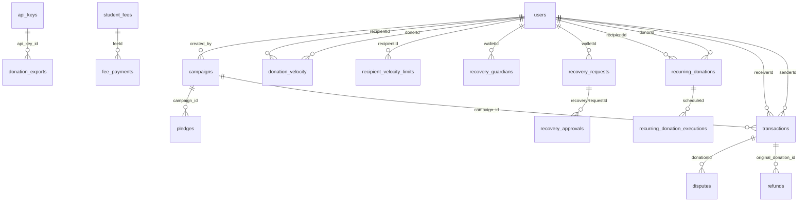

# Database Schema

<!-- AUTO-GENERATED — do not edit by hand.
     Regenerate with: npm run docs:db-schema
     Source: every migration in src/migrations, applied to an empty SQLite database.
     CI verifies this file with: npm run docs:db-schema:check -->

This document is generated from the migrations the application runs. The
hand-written schema that used to live in the README drifted from the code, so it
has been removed. For the amounts column rules see [ADR-004](adr/004-money-as-stroops.md).

Limitation: a few tables are created lazily by model code at runtime rather than by a
migration (for example `webhooks` and `matching_programs`). They are not listed here.

**Tables:** 39 · **Indexes:** 48 · **Foreign keys:** 18

## Entity relationships

## Tables

### `anomaly_history`

| Column | Type | Not null | Default | Primary key |
|--------|------|----------|---------|-------------|
| `id` | INTEGER | no | — | yes |
| `key_id` | TEXT | yes | — | no |
| `ip` | TEXT | no | — | no |
| `country` | TEXT | no | — | no |
| `hour` | INTEGER | no | — | no |
| `request_timestamp` | INTEGER | yes | — | no |
| `endpoint` | TEXT | no | — | no |
| `created_at` | INTEGER | yes | — | no |

**Indexes**

- `idx_anomaly_history_key_id` (index on `key_id`)
- `idx_anomaly_history_request_timestamp` (index on `request_timestamp`)

### `anomaly_records`

| Column | Type | Not null | Default | Primary key |
|--------|------|----------|---------|-------------|
| `id` | INTEGER | no | — | yes |
| `key_id` | TEXT | yes | — | no |
| `type` | TEXT | yes | — | no |
| `detail` | TEXT | no | — | no |
| `timestamp` | INTEGER | yes | — | no |
| `created_at` | INTEGER | yes | — | no |

**Indexes**

- `idx_anomaly_records_key_id` (index on `key_id`)
- `idx_anomaly_records_timestamp` (index on `timestamp`)

### `api_key_usage`

| Column | Type | Not null | Default | Primary key |
|--------|------|----------|---------|-------------|
| `id` | INTEGER | no | — | yes |
| `api_key` | TEXT | yes | — | no |
| `timestamp` | INTEGER | yes | — | no |
| `latency_ms` | INTEGER | yes | — | no |
| `status_code` | INTEGER | yes | — | no |
| `path` | TEXT | yes | '/' | no |
| `method` | TEXT | yes | 'GET' | no |

**Indexes**

- `idx_api_key_usage_api_key` (index on `api_key`)
- `idx_api_key_usage_api_key_timestamp` (index on `api_key`, `timestamp`)

### `api_keys`

| Column | Type | Not null | Default | Primary key |
|--------|------|----------|---------|-------------|
| `id` | INTEGER | no | — | yes |
| `key_hash` | TEXT | yes | — | no |
| `key_prefix` | TEXT | yes | — | no |
| `name` | TEXT | yes | — | no |
| `role` | TEXT | yes | 'user' | no |
| `status` | TEXT | yes | 'active' | no |
| `created_by` | TEXT | no | — | no |
| `metadata` | TEXT | no | — | no |
| `expires_at` | INTEGER | no | — | no |
| `last_used_at` | INTEGER | no | — | no |
| `deprecated_at` | INTEGER | no | — | no |
| `revoked_at` | INTEGER | no | — | no |
| `created_at` | INTEGER | yes | — | no |
| `grace_period_days` | INTEGER | yes | 30 | no |
| `rotated_to_id` | INTEGER | no | — | no |
| `signing_required` | INTEGER | yes | 0 | no |
| `key_secret` | TEXT | no | — | no |
| `scopes` | TEXT | no | — | no |
| `allowed_ips` | TEXT | no | — | no |
| `monthly_quota` | INTEGER | no | — | no |
| `quota_used` | INTEGER | yes | 0 | no |
| `quota_reset_at` | INTEGER | no | — | no |
| `tenant_id` | TEXT | yes | 'default' | no |
| `notification_email` | TEXT | no | — | no |
| `last_expiry_notification_sent_at` | INTEGER | no | — | no |
| `rate_limit_per_minute` | INTEGER | no | NULL | no |

**Indexes**

- `idx_api_keys_key_hash` (index on `key_hash`)
- `idx_api_keys_status` (index on `status`)

### `audit_logs`

| Column | Type | Not null | Default | Primary key |
|--------|------|----------|---------|-------------|
| `id` | INTEGER | no | — | yes |
| `timestamp` | TEXT | yes | — | no |
| `category` | TEXT | yes | — | no |
| `action` | TEXT | yes | — | no |
| `severity` | TEXT | yes | — | no |
| `result` | TEXT | yes | — | no |
| `userId` | TEXT | no | — | no |
| `requestId` | TEXT | no | — | no |
| `ipAddress` | TEXT | no | — | no |
| `resource` | TEXT | no | — | no |
| `reason` | TEXT | no | — | no |
| `details` | TEXT | no | — | no |
| `integrityHash` | TEXT | yes | — | no |
| `createdAt` | DATETIME | no | CURRENT_TIMESTAMP | no |

**Indexes**

- `idx_audit_logs_action` (index on `action`)
- `idx_audit_logs_category` (index on `category`)
- `idx_audit_logs_requestId` (index on `requestId`)
- `idx_audit_logs_severity` (index on `severity`)
- `idx_audit_logs_timestamp` (index on `timestamp`)
- `idx_audit_logs_userId` (index on `userId`)

### `campaigns`

| Column | Type | Not null | Default | Primary key |
|--------|------|----------|---------|-------------|
| `id` | INTEGER | no | — | yes |
| `name` | TEXT | yes | — | no |
| `description` | TEXT | no | — | no |
| `goal_amount` | REAL | yes | — | no |
| `current_amount` | REAL | no | 0 | no |
| `start_date` | DATETIME | no | — | no |
| `end_date` | DATETIME | no | — | no |
| `status` | TEXT | no | 'active' | no |
| `created_by` | INTEGER | no | — | no |
| `createdAt` | DATETIME | no | CURRENT_TIMESTAMP | no |
| `updatedAt` | DATETIME | no | CURRENT_TIMESTAMP | no |
| `deleted_at` | DATETIME | no | NULL | no |
| `tenant_id` | TEXT | yes | 'default' | no |

**Foreign keys**

- `created_by` → `users`(`id`)

### `circuit_breaker_state`

| Column | Type | Not null | Default | Primary key |
|--------|------|----------|---------|-------------|
| `name` | TEXT | no | — | yes |
| `state` | TEXT | yes | 'closed' | no |
| `failureCount` | INTEGER | yes | 0 | no |
| `lastFailureAt` | INTEGER | no | — | no |
| `openedAt` | INTEGER | no | — | no |
| `probeHolder` | TEXT | no | NULL | no |

### `corporate_claims`

| Column | Type | Not null | Default | Primary key |
|--------|------|----------|---------|-------------|
| `id` | TEXT | no | — | yes |
| `donorId` | TEXT | yes | — | no |
| `employerId` | TEXT | yes | — | no |
| `donationAmount` | REAL | yes | — | no |
| `matchAmount` | REAL | yes | — | no |
| `status` | TEXT | yes | 'pending' | no |
| `createdAt` | TEXT | yes | — | no |
| `reviewedAt` | TEXT | no | — | no |
| `rejectReason` | TEXT | no | — | no |
| `txId` | TEXT | no | — | no |

**Indexes**

- `idx_corporate_claims_employer_donor` (index on `employerId`, `donorId`, `status`, `createdAt`)

### `corporate_employers`

| Column | Type | Not null | Default | Primary key |
|--------|------|----------|---------|-------------|
| `id` | TEXT | no | — | yes |
| `name` | TEXT | yes | — | no |
| `matchRatio` | REAL | yes | — | no |
| `annualCap` | REAL | yes | — | no |
| `addedAt` | TEXT | yes | — | no |

**Indexes**

- `idx_corporate_employers_id` (index on `id`)

### `dedup_cache`

| Column | Type | Not null | Default | Primary key |
|--------|------|----------|---------|-------------|
| `fingerprint` | TEXT | yes | — | yes |
| `apiKeyId` | TEXT | no | — | no |
| `api_key_scope` | TEXT | yes | '' | yes |
| `status_code` | INTEGER | yes | — | no |
| `body` | TEXT | yes | — | no |
| `created_at` | DATETIME | no | CURRENT_TIMESTAMP | no |
| `expires_at` | DATETIME | yes | — | no |

**Indexes**

- `idx_dedup_expires` (index on `expires_at`)

### `disputes`

| Column | Type | Not null | Default | Primary key |
|--------|------|----------|---------|-------------|
| `id` | INTEGER | no | — | yes |
| `donationId` | INTEGER | yes | — | no |
| `recipientPublicKey` | TEXT | yes | — | no |
| `reason` | TEXT | yes | — | no |
| `evidence` | TEXT | no | — | no |
| `status` | TEXT | no | 'open' | no |
| `createdAt` | DATETIME | no | CURRENT_TIMESTAMP | no |
| `updatedAt` | DATETIME | no | CURRENT_TIMESTAMP | no |
| `resolvedAt` | DATETIME | no | — | no |
| `resolutionNotes` | TEXT | no | — | no |

**Foreign keys**

- `donationId` → `transactions`(`id`)

**Indexes**

- `idx_disputes_recipientPublicKey` (index on `recipientPublicKey`)
- `idx_disputes_status` (index on `status`)

### `donation_exports`

| Column | Type | Not null | Default | Primary key |
|--------|------|----------|---------|-------------|
| `id` | INTEGER | no | — | yes |
| `export_id` | TEXT | yes | — | no |
| `api_key_id` | TEXT | yes | — | no |
| `start_date` | TEXT | no | — | no |
| `end_date` | TEXT | no | — | no |
| `status_filter` | TEXT | no | — | no |
| `sender_public_key` | TEXT | no | — | no |
| `recipient_public_key` | TEXT | no | — | no |
| `format` | TEXT | yes | — | no |
| `status` | TEXT | yes | — | no |
| `record_count` | INTEGER | no | 0 | no |
| `file_path` | TEXT | no | — | no |
| `error_message` | TEXT | no | — | no |
| `signed_url` | TEXT | no | — | no |
| `signed_url_expires_at` | TEXT | no | — | no |
| `created_at` | TEXT | yes | — | no |
| `updated_at` | TEXT | no | — | no |

**Foreign keys**

- `api_key_id` → `api_keys`(`id`)

### `donation_totals`

| Column | Type | Not null | Default | Primary key |
|--------|------|----------|---------|-------------|
| `recipient_id` | TEXT | yes | — | yes |
| `total_stroops` | TEXT | yes | '0' | no |
| `donation_count` | INTEGER | yes | 0 | no |
| `updated_at` | DATETIME | no | CURRENT_TIMESTAMP | no |

### `donation_totals_global`

| Column | Type | Not null | Default | Primary key |
|--------|------|----------|---------|-------------|
| `id` | INTEGER | no | — | yes |
| `total_stroops` | TEXT | yes | '0' | no |
| `donation_count` | INTEGER | yes | 0 | no |
| `updated_at` | DATETIME | no | CURRENT_TIMESTAMP | no |

### `donation_velocity`

| Column | Type | Not null | Default | Primary key |
|--------|------|----------|---------|-------------|
| `id` | INTEGER | no | — | yes |
| `donorId` | INTEGER | yes | — | no |
| `recipientId` | INTEGER | yes | — | no |
| `windowStart` | DATETIME | yes | — | no |
| `totalAmount` | REAL | yes | 0 | no |
| `count` | INTEGER | yes | 0 | no |
| `updatedAt` | DATETIME | no | CURRENT_TIMESTAMP | no |

**Foreign keys**

- `recipientId` → `users`(`id`)
- `donorId` → `users`(`id`)

**Indexes**

- `idx_velocity_donor_recipient_window` (unique index on `donorId`, `recipientId`, `windowStart`)

### `donations_store`

| Column | Type | Not null | Default | Primary key |
|--------|------|----------|---------|-------------|
| `id` | TEXT | no | — | yes |
| `donor` | TEXT | no | — | no |
| `recipient` | TEXT | no | — | no |
| `amount_stroops` | INTEGER | no | — | no |
| `amount_text` | TEXT | yes | — | no |
| `status` | TEXT | yes | 'pending' | no |
| `idempotency_key` | TEXT | no | — | no |
| `stellar_tx_id` | TEXT | no | — | no |
| `timestamp` | TEXT | yes | — | no |
| `status_updated_at` | TEXT | no | — | no |
| `deleted_at` | TEXT | no | — | no |
| `data` | TEXT | yes | — | no |

**Indexes**

- `idx_donations_store_donor` (index on `donor`)
- `idx_donations_store_idempotency` (index on `idempotency_key`)
- `idx_donations_store_recipient` (index on `recipient`)
- `idx_donations_store_status` (index on `status`)
- `idx_donations_store_stellar_tx` (index on `stellar_tx_id`)

### `fee_payments`

| Column | Type | Not null | Default | Primary key |
|--------|------|----------|---------|-------------|
| `id` | INTEGER | no | — | yes |
| `feeId` | INTEGER | yes | — | no |
| `amount` | REAL | yes | — | no |
| `note` | TEXT | no | — | no |
| `paidAt` | DATETIME | no | CURRENT_TIMESTAMP | no |
| `deleted_at` | DATETIME | no | NULL | no |
| `tenant_id` | TEXT | yes | 'default' | no |

**Foreign keys**

- `feeId` → `student_fees`(`id`)

### `geo_rules`

| Column | Type | Not null | Default | Primary key |
|--------|------|----------|---------|-------------|
| `id` | INTEGER | no | — | yes |
| `countryCode` | TEXT | yes | — | no |
| `ruleType` | TEXT | yes | — | no |
| `createdAt` | DATETIME | no | CURRENT_TIMESTAMP | no |
| `createdBy` | TEXT | no | — | no |

**Indexes**

- `idx_geo_rules_type_country` (index on `ruleType`, `countryCode`)

### `idempotency_keys`

| Column | Type | Not null | Default | Primary key |
|--------|------|----------|---------|-------------|
| `id` | INTEGER | no | — | yes |
| `apiKeyId` | INTEGER | no | — | no |
| `idempotencyKey` | VARCHAR(255) | yes | — | no |
| `requestHash` | VARCHAR(64) | yes | — | no |
| `response` | TEXT | yes | '' | no |
| `status` | TEXT | yes | 'completed' | no |
| `userId` | INTEGER | no | — | no |
| `createdAt` | DATETIME | yes | CURRENT_TIMESTAMP | no |
| `expiresAt` | DATETIME | yes | — | no |

**Indexes**

- `idx_idempotency_expires` (index on `expiresAt`)
- `idx_idempotency_key_lookup` (index on `apiKeyId`, `idempotencyKey`)

### `migration_lock`

| Column | Type | Not null | Default | Primary key |
|--------|------|----------|---------|-------------|
| `id` | INTEGER | no | — | yes |
| `instance_id` | TEXT | yes | — | no |
| `acquired_at` | DATETIME | no | CURRENT_TIMESTAMP | no |

### `nonce_store`

| Column | Type | Not null | Default | Primary key |
|--------|------|----------|---------|-------------|
| `nonce` | TEXT | no | — | yes |
| `usedAt` | DATETIME | no | CURRENT_TIMESTAMP | no |
| `expiresAt` | DATETIME | yes | — | no |

**Indexes**

- `idx_nonce_store_expiresAt` (index on `expiresAt`)

### `payment_streams`

| Column | Type | Not null | Default | Primary key |
|--------|------|----------|---------|-------------|
| `id` | INTEGER | no | — | yes |
| `public_key` | TEXT | yes | — | no |
| `webhook_url` | TEXT | no | — | no |
| `cursor` | TEXT | no | — | no |
| `created_at` | DATETIME | no | CURRENT_TIMESTAMP | no |
| `updated_at` | DATETIME | no | CURRENT_TIMESTAMP | no |

**Indexes**

- `idx_payment_streams_public_key` (index on `public_key`)

### `pledges`

| Column | Type | Not null | Default | Primary key |
|--------|------|----------|---------|-------------|
| `id` | TEXT | no | — | yes |
| `campaign_id` | INTEGER | yes | — | no |
| `donor_wallet_id` | TEXT | yes | — | no |
| `amount` | INTEGER | yes | — | no |
| `status` | TEXT | yes | 'pending' | no |
| `expires_at` | DATETIME | yes | — | no |
| `cancel_reason` | TEXT | no | — | no |
| `cancelled_at` | DATETIME | no | — | no |
| `created_at` | DATETIME | no | CURRENT_TIMESTAMP | no |

**Foreign keys**

- `campaign_id` → `campaigns`(`id`)

**Indexes**

- `idx_pledges_campaign` (index on `campaign_id`)
- `idx_pledges_expires` (index on `expires_at`)
- `idx_pledges_status` (index on `status`)

### `recipient_velocity_limits`

| Column | Type | Not null | Default | Primary key |
|--------|------|----------|---------|-------------|
| `id` | INTEGER | no | — | yes |
| `recipientId` | INTEGER | yes | — | no |
| `maxAmount` | REAL | no | — | no |
| `maxCount` | INTEGER | no | — | no |
| `windowType` | TEXT | yes | 'daily' | no |
| `createdAt` | DATETIME | no | CURRENT_TIMESTAMP | no |
| `updatedAt` | DATETIME | no | CURRENT_TIMESTAMP | no |

**Foreign keys**

- `recipientId` → `users`(`id`)

### `recovery_approvals`

| Column | Type | Not null | Default | Primary key |
|--------|------|----------|---------|-------------|
| `id` | INTEGER | no | — | yes |
| `recoveryRequestId` | INTEGER | yes | — | no |
| `guardianPublicKey` | TEXT | yes | — | no |
| `approvedAt` | DATETIME | no | CURRENT_TIMESTAMP | no |

**Foreign keys**

- `recoveryRequestId` → `recovery_requests`(`id`)

**Indexes**

- `idx_recovery_approvals_requestId` (index on `recoveryRequestId`)

### `recovery_guardians`

| Column | Type | Not null | Default | Primary key |
|--------|------|----------|---------|-------------|
| `id` | INTEGER | no | — | yes |
| `walletId` | INTEGER | yes | — | no |
| `guardianPublicKey` | TEXT | yes | — | no |
| `threshold` | INTEGER | no | — | no |
| `createdAt` | DATETIME | no | CURRENT_TIMESTAMP | no |

**Foreign keys**

- `walletId` → `users`(`id`)

**Indexes**

- `idx_recovery_guardians_walletId` (index on `walletId`)

### `recovery_requests`

| Column | Type | Not null | Default | Primary key |
|--------|------|----------|---------|-------------|
| `id` | INTEGER | no | — | yes |
| `walletId` | INTEGER | yes | — | no |
| `newPublicKey` | TEXT | yes | — | no |
| `status` | TEXT | yes | 'pending' | no |
| `threshold` | INTEGER | yes | — | no |
| `executeAfter` | DATETIME | yes | — | no |
| `createdAt` | DATETIME | no | CURRENT_TIMESTAMP | no |
| `executedAt` | DATETIME | no | — | no |

**Foreign keys**

- `walletId` → `users`(`id`)

**Indexes**

- `idx_recovery_requests_walletId` (index on `walletId`)

### `recurring_donation_executions`

| Column | Type | Not null | Default | Primary key |
|--------|------|----------|---------|-------------|
| `id` | INTEGER | no | — | yes |
| `scheduleId` | INTEGER | yes | — | no |
| `executedAt` | TEXT | yes | — | no |
| `status` | TEXT | yes | — | no |
| `transactionHash` | TEXT | no | — | no |
| `errorMessage` | TEXT | no | — | no |
| `createdAt` | TEXT | yes | datetime('now') | no |
| `retryCount` | INTEGER | no | 0 | no |
| `durationMs` | INTEGER | no | 0 | no |

**Foreign keys**

- `scheduleId` → `recurring_donations`(`id`)

**Indexes**

- `idx_rde_scheduleId` (index on `scheduleId`, `executedAt`)

### `recurring_donations`

| Column | Type | Not null | Default | Primary key |
|--------|------|----------|---------|-------------|
| `id` | INTEGER | no | — | yes |
| `donorId` | INTEGER | yes | — | no |
| `recipientId` | INTEGER | yes | — | no |
| `amount` | REAL | yes | — | no |
| `frequency` | TEXT | yes | — | no |
| `nextExecutionDate` | DATETIME | yes | — | no |
| `status` | TEXT | no | 'active' | no |
| `executionCount` | INTEGER | no | 0 | no |
| `customIntervalDays` | INTEGER | no | NULL | no |
| `maxExecutions` | INTEGER | no | NULL | no |
| `webhookUrl` | TEXT | no | NULL | no |
| `failureCount` | INTEGER | no | 0 | no |
| `lastExecutionDate` | DATETIME | no | NULL | no |
| `tenant_id` | TEXT | yes | 'default' | no |
| `cancelledAt` | DATETIME | no | NULL | no |

**Foreign keys**

- `recipientId` → `users`(`id`)
- `donorId` → `users`(`id`)

**Indexes**

- `idx_recurring_donations_status_nextExecution` (index on `status`, `nextExecutionDate`)

### `refresh_tokens`

| Column | Type | Not null | Default | Primary key |
|--------|------|----------|---------|-------------|
| `id` | INTEGER | no | — | yes |
| `token_hash` | TEXT | yes | — | no |
| `api_key_id` | INTEGER | yes | — | no |
| `family_id` | TEXT | yes | — | no |
| `expires_at` | INTEGER | yes | — | no |
| `used_at` | INTEGER | no | — | no |
| `revoked` | INTEGER | yes | 0 | no |
| `revoked_at` | INTEGER | no | — | no |
| `revoke_reason` | TEXT | no | — | no |
| `created_at` | INTEGER | yes | — | no |

**Indexes**

- `idx_refresh_tokens_api_key_id` (index on `api_key_id`)
- `idx_refresh_tokens_family_id` (index on `family_id`)

### `refunds`

| Column | Type | Not null | Default | Primary key |
|--------|------|----------|---------|-------------|
| `id` | INTEGER | no | — | yes |
| `original_donation_id` | TEXT | yes | — | no |
| `reverse_transaction_id` | TEXT | yes | — | no |
| `amount` | REAL | yes | — | no |
| `reason` | TEXT | no | — | no |
| `notes` | TEXT | no | — | no |
| `idempotency_key` | TEXT | no | — | no |
| `refunded_at` | DATETIME | yes | — | no |
| `stellar_ledger` | INTEGER | no | — | no |
| `status` | TEXT | no | 'completed' | no |
| `created_at` | DATETIME | no | CURRENT_TIMESTAMP | no |

**Foreign keys**

- `original_donation_id` → `transactions`(`id`)

**Indexes**

- `idx_refunds_idempotency_key` (index on `idempotency_key`)
- `idx_refunds_original_donation_id` (index on `original_donation_id`)
- `idx_refunds_status` (index on `status`)

### `rotation_locks`

| Column | Type | Not null | Default | Primary key |
|--------|------|----------|---------|-------------|
| `name` | TEXT | no | — | yes |
| `status` | TEXT | yes | 'idle' | no |
| `startedAt` | TEXT | no | — | no |
| `completedAt` | TEXT | no | — | no |
| `error` | TEXT | no | — | no |
| `createdAt` | TEXT | yes | CURRENT_TIMESTAMP | no |
| `updatedAt` | TEXT | yes | CURRENT_TIMESTAMP | no |

### `scheduler_locks`

| Column | Type | Not null | Default | Primary key |
|--------|------|----------|---------|-------------|
| `name` | TEXT | no | — | yes |
| `holder_id` | TEXT | yes | — | no |
| `acquired_at` | INTEGER | yes | — | no |
| `expires_at` | INTEGER | yes | — | no |

### `schema_migrations`

| Column | Type | Not null | Default | Primary key |
|--------|------|----------|---------|-------------|
| `id` | INTEGER | no | — | yes |
| `name` | TEXT | yes | — | no |
| `applied_at` | DATETIME | no | CURRENT_TIMESTAMP | no |
| `checksum` | TEXT | yes | '' | no |

### `sep10_challenges`

| Column | Type | Not null | Default | Primary key |
|--------|------|----------|---------|-------------|
| `challengeId` | TEXT | no | — | yes |
| `account` | TEXT | yes | — | no |
| `expiresAt` | INTEGER | yes | — | no |
| `issuedAt` | INTEGER | yes | — | no |
| `used` | INTEGER | yes | 0 | no |
| `usedAt` | INTEGER | no | — | no |

**Indexes**

- `idx_sep10_challenges_expires` (index on `expiresAt`)

### `student_fees`

| Column | Type | Not null | Default | Primary key |
|--------|------|----------|---------|-------------|
| `id` | INTEGER | no | — | yes |
| `studentId` | TEXT | yes | — | no |
| `description` | TEXT | yes | — | no |
| `totalAmount` | REAL | yes | — | no |
| `paidAmount` | REAL | yes | 0 | no |
| `createdAt` | DATETIME | no | CURRENT_TIMESTAMP | no |
| `updatedAt` | DATETIME | no | CURRENT_TIMESTAMP | no |
| `deleted_at` | DATETIME | no | NULL | no |
| `tenant_id` | TEXT | yes | 'default' | no |

### `transactions`

| Column | Type | Not null | Default | Primary key |
|--------|------|----------|---------|-------------|
| `id` | INTEGER | no | — | yes |
| `senderId` | INTEGER | yes | — | no |
| `receiverId` | INTEGER | yes | — | no |
| `amount` | INTEGER | yes | — | no |
| `memo` | TEXT | no | — | no |
| `notes` | TEXT | no | — | no |
| `tags` | TEXT | no | — | no |
| `timestamp` | DATETIME | no | CURRENT_TIMESTAMP | no |
| `deleted_at` | DATETIME | no | NULL | no |
| `idempotencyKey` | TEXT | no | — | no |
| `stellar_tx_id` | TEXT | no | — | no |
| `is_orphan` | INTEGER | yes | 0 | no |
| `campaign_id` | INTEGER | no | — | no |
| `validAfter` | INTEGER | no | 0 | no |
| `validBefore` | INTEGER | no | 0 | no |
| `tenant_id` | TEXT | yes | 'default' | no |

**Foreign keys**

- `receiverId` → `users`(`id`)
- `senderId` → `users`(`id`)
- `campaign_id` → `campaigns`(`id`)

**Indexes**

- `idx_transactions_idempotency` (index on `idempotencyKey`)
- `idx_transactions_idempotency_key_unique` (unique index on `idempotencyKey`)

### `users`

| Column | Type | Not null | Default | Primary key |
|--------|------|----------|---------|-------------|
| `id` | INTEGER | no | — | yes |
| `publicKey` | TEXT | yes | — | no |
| `encryptedSecret` | TEXT | no | — | no |
| `createdAt` | DATETIME | no | CURRENT_TIMESTAMP | no |
| `deleted_at` | DATETIME | no | NULL | no |
| `daily_limit` | REAL | no | NULL | no |
| `monthly_limit` | REAL | no | NULL | no |
| `per_transaction_limit` | REAL | no | NULL | no |
| `tenant_id` | TEXT | yes | 'default' | no |

### `wallets`

| Column | Type | Not null | Default | Primary key |
|--------|------|----------|---------|-------------|
| `id` | TEXT | no | — | yes |
| `address` | TEXT | yes | — | no |
| `label` | TEXT | no | — | no |
| `ownerName` | TEXT | no | — | no |
| `notes` | TEXT | no | — | no |
| `leaderboard_visibility` | INTEGER | no | 1 | no |
| `last_synced_at` | TEXT | no | — | no |
| `last_cursor` | TEXT | no | — | no |
| `createdAt` | TEXT | yes | — | no |
| `updatedAt` | TEXT | no | — | no |
| `deletedAt` | TEXT | no | — | no |
| `donation_limit_min` | INTEGER | no | — | no |
| `donation_limit_max` | INTEGER | no | — | no |

**Indexes**

- `idx_wallets_address` (index on `address`)
- `idx_wallets_donation_limits` (index on `donation_limit_min`, `donation_limit_max`)
